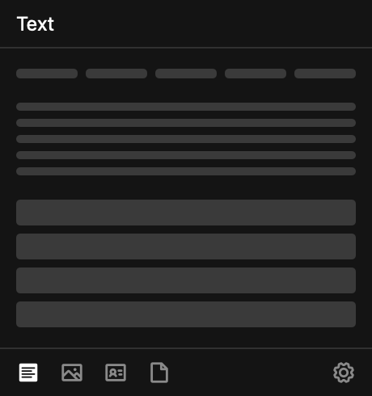
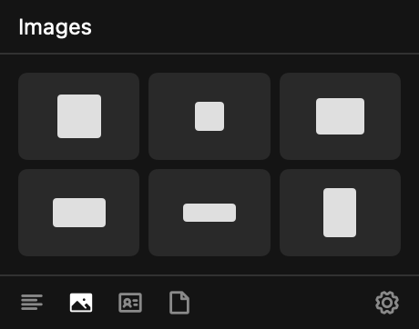
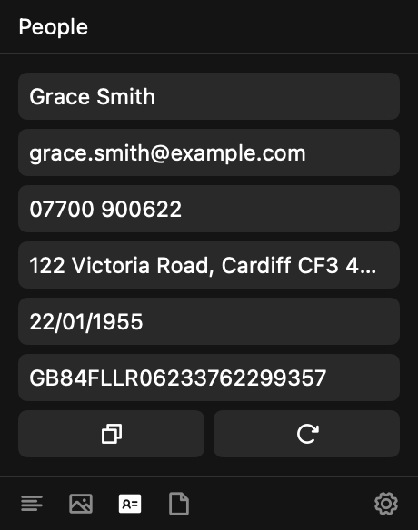
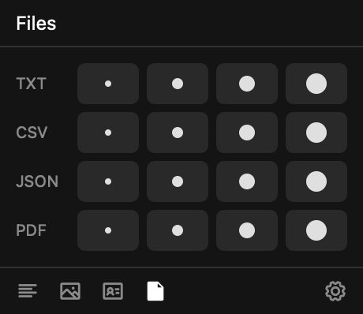
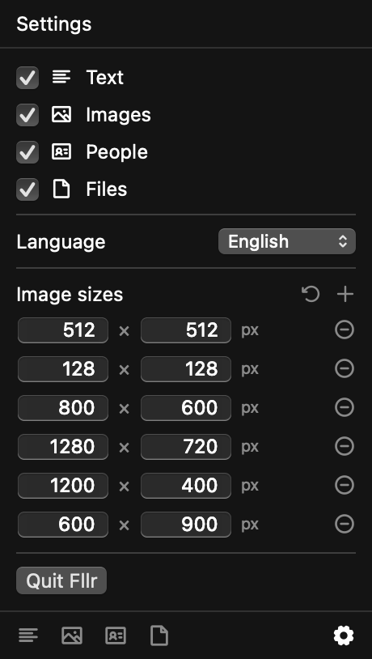

<p align="center">
  
</p>

<h1 align="center">Fllr</h1>

<p align="center">
  <strong>Filler content, one click away.</strong><br>
  A tiny macOS menu bar app that puts placeholder text, images, people and files on your clipboard.
</p>

<p align="center">
  <a href="https://willmuijrers.github.io/Fllr/">Website</a> ·
  <a href="#build-it">Build it</a> ·
  <a href="#what-it-fills">What it fills</a> ·
  <a href="#where-the-content-comes-from">Content sources</a>
</p>

<p align="center">
  
  
  
</p>

---

## How it works

1. Click the Fllr mark in your menu bar.
2. Hover over a bar or tile. The top line tells you what a click will copy, for example *Copy 3 sentences*.
3. Click. The content is on your clipboard, the popover closes and a notification confirms what was copied.

That is the whole app. The interface shows shapes rather than labels; anything extra appears on hover. It is inspired by [LittleIpsum](https://apps.apple.com/app/littleipsum/id405772121), which has not been updated since 2017.

## What it fills

Fllr is built from *fillrs*. Each one is a tab, and you choose in the settings which ones you want. Text and Images are on by default.

| Fillr | A click copies | Hold ⌥ while clicking | Drag |
|---|---|---|---|
| **Text** | 1–5 words, 1–5 sentences or 1–4 paragraphs of lorem ipsum | The same text wrapped in `<p>` tags | – |
| **Images** | A placeholder PNG at the exact pixel size | An `` tag with matching width and height | The PNG, into any app |
| **People** | One field of a fictional person: name, email, phone, address, date of birth or IBAN | The whole person as JSON (on the *everything* tile) | – |
| **Files** | A dummy TXT, CSV, JSON or PDF of 1 KB, 100 KB, 1 MB or 10 MB | – | The file, into any app |

<p align="center">
  
  
</p>

### Settings

- **Fillrs:** tick the tabs you want. With only one enabled, the tab bar disappears.
- **Language:** English (default), Deutsch, Français or Nederlands. The switch is instant.
- **Image sizes:** edit the width and height of any size in pixels, add your own or remove the ones you never use. A reset button brings back the defaults.

## Where the content comes from

Everything is generated on your Mac. Fllr makes no network requests and collects nothing.

- **Text:** classic lorem ipsum. The first words are always *Lorem ipsum dolor sit amet*; the rest is drawn at random from a pool of about 80 Latin words built into the app.
- **Images:** drawn locally with AppKit as a grey rectangle with diagonals and its dimensions. The optional `` tag points to [placehold.co](https://placehold.co), so that variant needs a connection wherever you paste it; the copied PNG does not.
- **People:** invented, and matched to the selected language so the data looks local:

  | Language | Country | Phone | IBAN |
  |---|---|---|---|
  | English | United Kingdom | `07700 900xxx`, the range Ofcom reserves for fiction | `GB…FLLR…` |
  | Deutsch | Germany | `0151 …` | `DE…99999999…` |
  | Français | France | `06 …` | `FR…99999 00000…` |
  | Nederlands | Netherlands | `06-…` | `NL…FLLR…` |

  Names, streets and cities come from short built-in lists of common ones. Email addresses always end in `@example.com`. IBANs have a valid checksum so they pass form validation, but they use bank codes that do not exist. Phone numbers outside the UK are random and could, by chance, belong to someone.
- **Files:** TXT and PDF are exactly the requested size. CSV and JSON stay just under it (within about 5%) so they remain valid; they are filled with the same fictional people.
- **Icons:** [Phosphor Icons](https://phosphoricons.com) in Bold and Fill, under the MIT licence (included in `Resources/Icons`). The menu bar mark is Fllr's own.

## Build it

There is no download yet; you build Fllr yourself. It takes about a minute.

**Requirements:** macOS 14 or later and the Xcode Command Line Tools (`xcode-select --install`). Full Xcode is not needed.

```bash
git clone https://github.com/WillMuijrers/Fllr.git
```

```bash
cd Fllr && ./build.sh --run
```

This compiles a release build, assembles `build/Fllr.app` and launches it. On first launch macOS asks whether Fllr may send notifications; allow it to get the *copied* confirmation.

Two extra commands help while developing:

```bash
build/Fllr.app/Contents/MacOS/Fllr --selftest
```

```bash
build/Fllr.app/Contents/MacOS/Fllr --snapshot build/snapshots
```

The first checks every generator (file sizes, IBAN checksums, image dimensions). The second renders every screen in every language to PNG, which is how the screenshots on this page were made.

## Project layout

```
Sources/Fllr/
  FllrApp.swift      menu bar item, popover, notifications
  Fillr.swift        the list of fillrs and the app state
  ContentView.swift  header, tab bar, settings
  LoremFillr.swift   text
  ImageFillr.swift   images and the size editor
  PeopleFillr.swift  fictional people per country
  FilesFillr.swift   dummy files
  Strings.swift      all four languages
  Theme.swift        colours
Resources/Icons/     Phosphor icons
Design/              logo and icon shape
```

Adding a fillr means one new case in `Fillr.swift`, its strings in `Strings.swift` and a view of its own.

## Status

Fllr is a personal project in an early state. Comments in the source are in Dutch.

- No signed or notarised download, and no App Store version yet.
- No app icon, launch at login or global shortcut yet.
- The repository has no licence file yet, so all rights are reserved for now.
